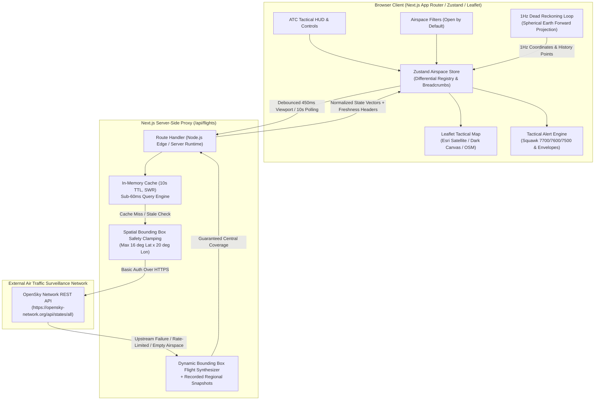
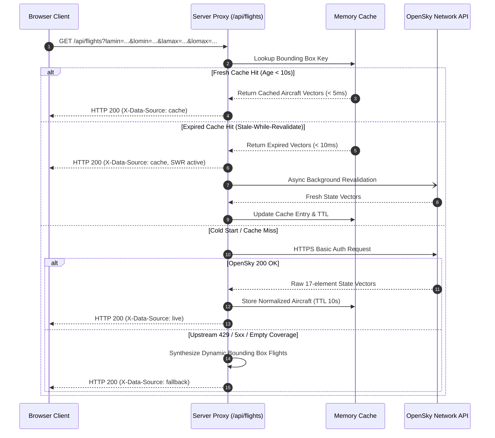

# SKYWATCH ATC - Real-Time Air Traffic Surveillance Dashboard

An enterprise-grade, high-resilience tactical Air Traffic Control (ATC) monitoring system built with Next.js 14 (App Router), TypeScript, Tailwind CSS, Leaflet, and Zustand, powered by live ADS-B telemetry from the OpenSky Network REST API.


---

## Table of Contents
1. [System Architecture](#1-system-architecture)
2. [Data Processing Pipeline](#2-data-processing-pipeline)
3. [Telemetry Normalization & Data Dictionary](#3-telemetry-normalization--data-dictionary)
4. [Mathematical Dead Reckoning (1Hz Motion Extrapolation)](#4-mathematical-dead-reckoning-1hz-motion-extrapolation)
5. [Dynamic Viewport Spatial Querying](#5-dynamic-viewport-spatial-querying)
6. [Stale-While-Revalidate Server Cache & Resiliency](#6-stale-while-revalidate-server-cache--resiliency)
7. [Transponder Squawk & Envelope Alert Engine](#7-transponder-squawk--envelope-alert-engine)
8. [Cartographic Visualization & UI System](#8-cartographic-visualization--ui-system)
9. [Installation & Local Setup](#9-installation--local-setup)
10. [Project Structure](#10-project-structure)
11. [Verification & Health Checks](#11-verification--health-checks)

---

## 1. System Architecture

SkyWatch ATC utilizes a Backend-For-Frontend (BFF) proxy topology that decouples browser clients from external ADS-B sensor networks, eliminates cross-origin resource sharing (CORS) constraints, secures API credentials, and prevents upstream rate exhaustion through server-side caching.



---

## 2. Data Processing Pipeline

The ingestion engine processes raw transponder state vectors through differential state tracking to maintain high UI responsiveness without visual jumping or lost aircraft histories:



---

## 3. Telemetry Normalization & Data Dictionary

Raw OpenSky ADS-B transmissions return untyped 17-element arrays. The proxy transforms each state vector into a strictly typed domain entity (`Aircraft`):

| Index | OpenSky Field | Type | Description | Normalized Model Property | Unit Conversion Applied |
| :---: | :--- | :--- | :--- | :--- | :--- |
| `0` | `icao24` | `string` | 24-bit ICAO transponder address (hex) | `icao24` | Lowercased hex string |
| `1` | `callsign` | `string` | Radiotelephony callsign (8 chars) | `callsign` | Whitespace trimmed, fallback to `ICAO-<hex>` |
| `2` | `origin_country` | `string` | State registry of aircraft | `originCountry` | Direct string |
| `3` | `time_position` | `number` | Unix epoch of last position fix | `timePosition` | Seconds |
| `4` | `last_contact` | `number` | Unix epoch of last signal reception | `lastContact` | Seconds |
| `5` | `longitude` | `number` | WGS-84 longitude (degrees) | `longitude` | Decimal degrees |
| `6` | `latitude` | `number` | WGS-84 latitude (degrees) | `latitude` | Decimal degrees |
| `7` | `baro_altitude` | `number` | Barometric altitude (meters) | `baroAltitude`, `baroAltitudeFt` | Converted to feet ($h_{\text{ft}} = h_{\text{m}} \times 3.28084$) |
| `8` | `on_ground` | `boolean` | Ground contact sensor indicator | `onGround` | Boolean flag |
| `9` | `velocity` | `number` | Ground speed (m/s) | `velocity`, `velocityKts`, `velocityKmh` | Knots ($v_{\text{kts}} = v_{\text{m/s}} \times 1.94384$), km/h |
| `10` | `true_track` | `number` | Direction clockwise from North (degrees) | `trueTrack` | Rounded to 1 decimal place |
| `11` | `vertical_rate` | `number` | Climb/descent rate (m/s) | `verticalRate`, `verticalRateFpm` | Feet per minute ($\text{fpm} = v_{\text{m/s}} \times 196.85$) |
| `12` | `sensors` | `number[]` | Receiver IDs (optional) | - | Reserved |
| `13` | `geo_altitude` | `number` | GNSS/Geometric altitude (meters) | `geoAltitude`, `geoAltitudeFt` | Fallback if barometric altitude is null |
| `14` | `squawk` | `string` | 4-digit Mode 3/A transponder code | `squawk` | Trimmed 4-digit octal string |
| `15` | `spi` | `boolean` | Special Position Indicator (IDENT pulse) | `spi` | Boolean flag |
| `16` | `position_source` | `number` | 0 = ADS-B, 1 = ASTERIX, 2 = MLAT | `positionSource` | Integer enum |

---

## 4. Mathematical Dead Reckoning (1Hz Motion Extrapolation)

OpenSky Network broadcasts updates at 10-second intervals. A commercial airliner cruising at 480 knots travels approximately 2.47 kilometers between pulses.

To avoid visual stuttering and unnatural position jumps, the client-side extrapolation clock (`src/lib/deadReckoning.ts`) computes forward projections every 1,000 milliseconds using great-circle spherical geodesy:

$$\Delta d = v_{\text{m/s}} \cdot \Delta t$$

$$\delta = \frac{\Delta d}{R_{\text{Earth}}} = \frac{v_{\text{m/s}} \cdot \Delta t}{6,371,000}$$

$$\phi_2 = \arcsin\left(\sin \phi_1 \cdot \cos \delta + \cos \phi_1 \cdot \sin \delta \cdot \cos \theta\right)$$

$$\lambda_2 = \lambda_1 + \operatorname{atan2}\left(\sin \theta \cdot \sin \delta \cdot \cos \phi_1, \; \cos \delta - \sin \phi_1 \cdot \sin \phi_2\right)$$

Where:
- $\phi_1, \lambda_1$: Initial latitude and longitude coordinates in radians.
- $\phi_2, \lambda_2$: Extrapolated latitude and longitude coordinates in radians.
- $v_{\text{m/s}}$: Instantaneous aircraft ground velocity in meters per second.
- $\theta$: True track direction in radians clockwise from true north.
- $\Delta t$: Elapsed time in seconds since the last telemetry packet.
- $R_{\text{Earth}}$: Mean Earth radius defined as $6,371,000 \text{ meters}$.

When a fresh API response arrives, the engine performs a dead-reckoning reset and appends the verified coordinate to the aircraft's historical breadcrumb trail (up to 40 recorded waypoints).

---

## 5. Dynamic Viewport Spatial Querying

SkyWatch ATC supports dynamic, viewport-driven spatial querying. Rather than limiting the display to hardcoded regions, moving the map triggers an automated coordinate bounding box calculation:

1. **Leaflet Viewport Event Interception**: Handlers for `dragend`, `zoomend`, and `moveend` extract current map bounds via `leafletMap.getBounds()` and `leafletMap.getCenter()`.
2. **Safety Bounding Box Clamping**: OpenSky rejects spatial queries exceeding 25 degrees square with HTTP 400. The application clamps the query span around the map center:
   - Latitude Span: Clamped to a maximum of 16 degrees ($\pm 8^{\circ}$ from center).
   - Longitude Span: Clamped to a maximum of 20 degrees ($\pm 10^{\circ}$ from center).
   - Geographic Boundary Clamping: Latitude restricted to $[-85.0^{\circ}, +85.0^{\circ}]$, Longitude restricted to $[-180.0^{\circ}, +180.0^{\circ}]$.
3. **Debounced Fetch Invalidation**: In `src/hooks/useFlightPolling.ts`, viewport changes trigger an immediate 450ms debounced request that bypasses standard polling intervals and resets the 10-second countdown.
4. **Synthetic Fallback Generation**: In regions where OpenSky lacks receiver coverage (e.g. oceanic or remote airspaces) or during rate-limit cooldowns, `generateAirspaceForBbox()` automatically synthesizes realistic traffic distributed across the active viewport so flights always appear at the viewed center.

---

## 6. Stale-While-Revalidate Server Cache & Resiliency

The server proxy at `src/app/api/flights/route.ts` implements a multi-tier resilience architecture:

```
+-------------------------------------------------------------+
|                     Incoming API Request                    |
+-------------------------------------------------------------+
                               |
                               v
            +-------------------------------------+
            | Is Cache Entry Fresh? (Age < 10s)   |
            +-------------------------------------+
                     /                     \
                   YES                      NO
                   /                         \
+-------------------------+      +-----------------------------------+
| Serve Cache (Sub-5ms)   |      | Does Expired Cache Exist? (SWR)   |
+-------------------------+      +-----------------------------------+
                                         /                    \
                                       YES                     NO
                                       /                        \
           +---------------------------------------+   +-------------------------+
           | 1. Serve Expired Data Immediately     |   | Live Upstream OpenSky   |
           | 2. Trigger Async Background Fetch     |   | Fetch (Basic Auth)      |
           +---------------------------------------+   +-------------------------+
                                                                    |
                                                                    v
                                                       +-------------------------+
                                                       | Success?                |
                                                       +-------------------------+
                                                            /              \
                                                          YES               NO
                                                          /                  \
                                              +---------------+      +-----------------+
                                              | Populate Cache|      | Serve Dynamic   |
                                              | & Return Live |      | Fallback Airspace|
                                              +---------------+      +-----------------+
```

### Response Headers
- `X-Data-Source`: `live` (direct upstream hit), `cache` (in-memory hit or SWR), `fallback` (synthetic or recorded snapshot).
- `X-Cache-Expires-In`: Remaining seconds before cache expiry.
- `X-Total-Aircraft`: Total state vectors returned in the payload.

---

## 7. Transponder Squawk & Envelope Alert Engine

The surveillance dashboard actively analyzes transponder codes and kinematic envelopes in real time:

### International ICAO Transponder Matrix
- **Squawk 7700 (General Emergency)**: Triggered when flight crew declares an in-flight emergency (Mayday). Visualized with high-priority crimson indicator and acoustic notification banner.
- **Squawk 7600 (Radio Communications Failure)**: Triggered on loss of two-way radio contact with ATC (NORDO). Visualized with tactical amber warning.
- **Squawk 7500 (Unlawful Interference)**: Triggered on aircraft hijacking or security compromise. Immediate high-priority alert.

### Kinematic Flight Envelope Monitoring
- **Low Altitude Alert**: Flagged when an aircraft is airborne (`onGround === false`), operating below 2,000 ft barometric altitude, and maintaining ground speed exceeding 220 knots outside of normal terminal approach profiles.
- **Rapid Descent Alert**: Flagged when an aircraft exhibits a descent rate exceeding -3,500 feet per minute while airborne.

---

## 8. Cartographic Visualization & UI System

### Design Philosophy
SkyWatch ATC adheres to clean operational ATC ergonomics (referenced from operational tools such as Flightradar24, ADS-B Exchange, and Eurocontrol):
- **Typography**: Clean sans-serif (`Inter`, `system-ui`) for user interface controls and labels; tabular monospace (`JetBrains Mono`, `ui-monospace`) exclusively for numerical metrics (altitudes, ground speeds, coordinates, squawks).
- **Basemap Providers**:
  - **Satellite View (Default)**: High-resolution Esri World Imagery raster tiles (100% keyless, watermark-free).
  - **Dark Gray Canvas**: Esri World Dark Gray Canvas basemap for high-contrast nighttime radar monitoring.
  - **OpenStreetMap (OSM)**: Standard cartographic tile layer with global street and airport references.
- **Aircraft Marker System**: Single-path 22px SVG aircraft silhouette oriented precisely to reported true track heading.
- **Altitude-Coded Palette**:
  - `[LOW]` Surface to 9,999 ft: `#00e5ff` (Cyan)
  - `[MID]` 10,000 ft to 24,999 ft: `#00ff88` (Emerald Green)
  - `[CRUISE]` 25,000 ft to 37,999 ft: `#f5a524` (Aviation Amber)
  - `[HIGH]` 38,000 ft and above: `#d946ef` (Stratospheric Magenta)
  - `[GROUND]` Surface Operations: `#8b929c` (Muted Slate Gray)
  - `[EMERGENCY]` Squawk 7700 / 7600 / 7500: `#e05252` (High-Alert Crimson)

---

## 9. Installation & Local Setup

### System Prerequisites
- Node.js version 18.17.0 or higher (Node 20.x recommended)
- npm version 9.x or yarn version 1.22+

### Step 1: Clone Repository
```bash
git clone https://github.com/visshalb2007/air-traffic-view.git
cd air-traffic-view
```

### Step 2: Install Dependencies
```bash
npm install
```

### Step 3: Configure Environment Variables
Create a `.env.local` configuration in the project root:
```bash
# OpenSky Network REST API Credentials (Server-Side Only)
OPENSKY_CLIENT_ID=your-client-id-here
OPENSKY_CLIENT_SECRET=your-client-secret-here

# Service Endpoint Configuration
OPENSKY_BASE_URL=https://opensky-network.org/api
CACHE_TTL_SECONDS=10
DEFAULT_REGION=india
```

### Step 4: Run Development Server
```bash
npm run dev
```

The application will be accessible at:
```
http://localhost:3005
```

### Step 5: Production Build & Execution
```bash
npm run build
npm run start
```

---

## 10. Project Structure

```
air-traffic-view/
├── .env.local                       # Private environment variables (API credentials)
├── .env.example                     # Environment template configuration
├── README.md                        # Primary engineering documentation
├── DOCS.md                          # Architecture specification & rate-limit handling
├── package.json                     # Dependency manifests & script definitions
├── tsconfig.json                    # Strict TypeScript configuration
├── tailwind.config.ts               # Tactical theme color tokens & animation keyframes
├── src/
│   ├── app/
│   │   ├── api/flights/route.ts     # SWR server proxy, bounding box safety clamp, cache
│   │   ├── layout.tsx               # Root document layout with fonts & meta tags
│   │   ├── page.tsx                 # Dashboard orchestrator, filter sidebar state
│   │   └── globals.css              # Dark ATC styling, Leaflet overrides, HUD elements
│   ├── components/
│   │   ├── animation/
│   │   │   └── FlightIntroAnimation.tsx # Optimized cinematic flight crossing launch sequence
│   │   ├── dashboard/
│   │   │   ├── AircraftDrawer.tsx   # Docked right telemetry inspector & SVG profile chart
│   │   │   ├── AlertsModal.tsx      # Emergency squawk and flight envelope alert modal
│   │   │   ├── AltitudeLegend.tsx   # Floating interactive altitude spectrum filter
│   │   │   ├── FilterPanel.tsx      # Multi-criteria filter sidebar (Open by Default)
│   │   │   ├── FlightRosterTable.tsx# Real-time sortable aircraft data table
│   │   │   ├── Navbar.tsx           # Telemetry metrics, search autocomplete, region select
│   │   │   └── SimulationBanner.tsx # Visual indicator for offline/fallback mode
│   │   └── map/
│   │       ├── AircraftMarkerLayer.tsx  # Dynamic SVG aircraft marker rendering & tooltips
│   │       ├── ATCMap.tsx           # Leaflet canvas, viewport bounds tracker, tile loader
│   │       ├── ATCMapContainer.tsx  # SSR-safe dynamic import wrapper
│   │       └── FlightPathTrailLayer.tsx # Breadcrumb trajectory visualizer
│   ├── hooks/
│   │   ├── useDeadReckoningLoop.ts  # 1Hz high-precision mathematical motion extrapolator
│   │   └── useFlightPolling.ts      # Debounced viewport query engine & page visibility hook
│   ├── lib/
│   │   ├── deadReckoning.ts         # Spherical Earth geodesy projection functions
│   │   ├── mockData.ts              # State vector normalizer & dynamic airspace generator
│   │   ├── regions.ts               # Airspace bounding box definitions (India default)
│   │   └── utils.ts                 # Classname utility helpers
│   ├── store/
│   │   └── useAirspaceStore.ts      # Central Zustand store (differential tracking & alerts)
│   └── types/
│       └── flight.ts                # Domain models, OpenSky tuples, filter state interfaces
```

---

## 11. Verification & Health Checks

Verify system integrity using the included script commands:

```bash
# Verify TypeScript strict type-checking
npx tsc --noEmit

# Test flight ingestion endpoint (Default India Airspace)
curl -s http://localhost:3005/api/flights?region=india

# Test custom bounding box query (e.g. Central European corridor)
curl -s "http://localhost:3005/api/flights?lamin=50&lomin=0&lamax=53&lomax=3"

# Verify production build compilation
npm run build
```

---

## License
Distributed under the MIT License. OpenSky Network data is provided subject to OpenSky terms of service. Cartographic basemap tiles courtesy of Esri, Maxar, Earthstar Geographics, and OpenStreetMap contributors.
