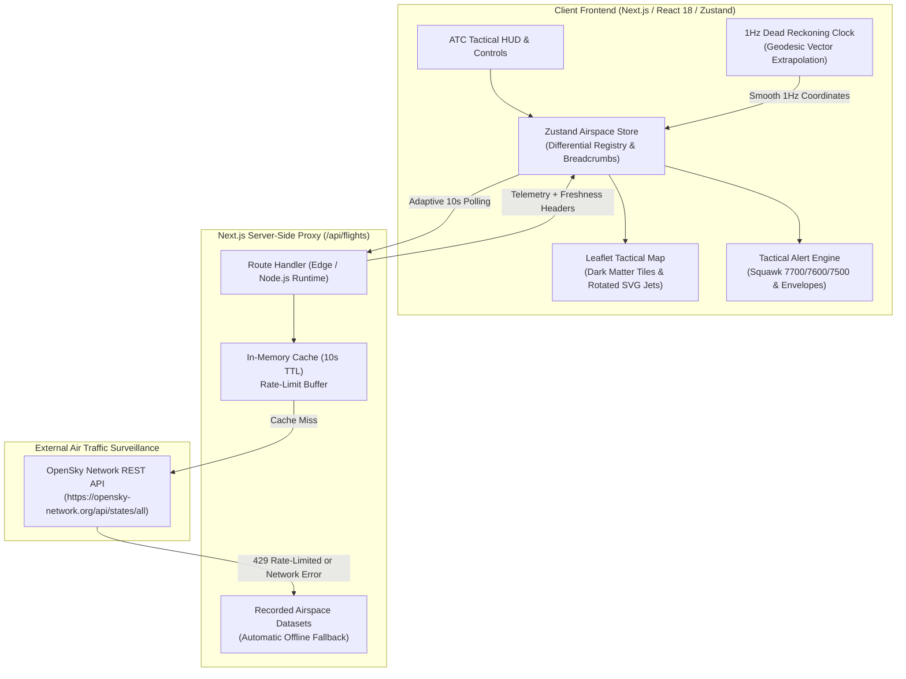

# SKYWATCH ATC — Real-Time Air Traffic Surveillance Dashboard

An enterprise-grade, high-resilience tactical Air Traffic Control (ATC) monitoring system built with **Next.js 14 (App Router)**, **TypeScript**, **Tailwind CSS**, **Leaflet**, and **Zustand**, powered by live telemetry from the **OpenSky Network REST API**.


---

## 🛫 Table of Contents
1. [System Architecture](#system-architecture)
2. [Key Features & Capabilities](#key-features--capabilities)
3. [OpenSky API Integration & Security](#opensky-api-integration--security)
4. [State Management & Differential Tracking](#state-management--differential-tracking)
5. [Mathematical Dead Reckoning (1Hz Position Extrapolation)](#mathematical-dead-reckoning)
6. [Resilience, Rate Limits & Failure Recovery](#resilience-rate-limits--failure-recovery)
7. [Installation & Local Setup](#installation--local-setup)
8. [Project Structure](#project-structure)

---

## 1. System Architecture

SkyWatch ATC implements a Backend-For-Frontend (BFF) proxy architecture that decouples browser clients from OpenSky Network's strict anonymous rate limits and CORS constraints.



---

## 2. Key Features & Capabilities

- **Interactive Tactical Radar Map**: CartoDB Dark Matter tiles, tactical vignette HUD, animated sweep, and custom rotated aircraft markers oriented to their true heading (`true_track`).
- **Altitude-Coded Telemetry**:
  - 🟢 **Low Altitude (< 10,000 ft)**: Emerald Green
  - 🔵 **Mid Altitude (10,000 – 25,000 ft)**: Tactical Cyan
  - 🟣 **High Altitude (> 25,000 ft)**: Altitude Purple
  - 🟠 **Ground Operations**: Caution Amber
  - 🔴 **Emergency Squawk (7700/7600/7500)**: Flashing High-Alert Crimson
- **Flight Path Breadcrumbs & Trajectory Inspection**: Historical flight waypoints logged during the session. Clicking any aircraft draws its path trail with interactive tooltips showing timestamp, altitude, speed, and heading at every recorded observation point.
- **Client-Side Dead Reckoning**: 1Hz mathematical motion extrapolator updates coordinates in real time between 10s OpenSky API pulses, ensuring silky-smooth movements without overloading network requests.
- **Configurable ATC Alerts**:
  - **Squawk 7700**: General Mayday / Aircraft Emergency
  - **Squawk 7600**: Radio Communications Failure
  - **Squawk 7500**: Unlawful Interference / Hijacking Alert
  - **Low Altitude Warning**: Aircraft airborne below 2,000 ft at high velocity
  - **Rapid Descent**: Descent rates exceeding -3,500 ft/min
- **Multi-Attribute Airspace Filtering**:
  - Callsign, ICAO 24 hex address, or country search.
  - Altitude range slider (0 to 50,000+ ft).
  - Ground speed slider (0 to 800+ kts).
  - Airborne vs. On-ground filter.
  - Emergency-only transponder squawk filter.
- **Flight Roster Data Table**: Collapsible real-time roster of tracked aircraft with instant sorting and one-click radar target lock.
- **Offline / Recorded Simulation Mode**: One-click switch to replay authentic recorded airspace snapshots (Heathrow, JFK, Mumbai, Tokyo, Dubai) when disconnected from the internet or experiencing rate limiting.

---

## 3. OpenSky API Integration & Security

### Why a Server-Side Proxy?
1. **Rate Limiting**: OpenSky anonymous requests are limited to **1 request every 10 seconds per IP** (~400 requests/day).
2. **CORS Restrictions**: Direct browser fetches to `opensky-network.org` can be blocked by CORS or browser user-agent filters.
3. **Credential Protection**: When using OpenSky authenticated API accounts (`clientId` & `clientSecret`), credentials must **never** be exposed in client bundles.

The Next.js route handler (`src/app/api/flights/route.ts`):
- Securely attaches HTTP Basic Auth using `OPENSKY_CLIENT_ID` and `OPENSKY_CLIENT_SECRET` on the server.
- Maintains an in-memory cache keyed by geographical bounding box with a 10-second TTL.
- Returns diagnostic headers:
  - `X-Data-Source: live | cache | fallback`
  - `X-Cache-Expires-In: <seconds>`
  - `X-Total-Aircraft: <count>`

---

## 4. State Management & Differential Tracking

The global application state is orchestrated using **Zustand** (`src/store/useAirspaceStore.ts`):

- **Differential Lifecycle Management**:
  - **New Arrivals**: Aircraft detected for the first time are tagged with `isNewArrival: true`.
  - **Differential State Retention**: If an aircraft temporarily vanishes in a single API update, it is not abruptly dropped. Instead, it transitions into `isStale: true` and is preserved for up to **120 seconds** before being pruned.
  - **Trajectory Buffering**: Maintains a sliding window of historical waypoints for each tracked ICAO24 address.
- **Page Visibility API Integration**:
  - When the user switches tabs or minimizes the window, the adaptive polling engine (`src/hooks/useFlightPolling.ts`) pauses background network calls.
  - On returning to the tab, if data is older than 12 seconds, an immediate refresh is triggered.

---

## 5. Mathematical Dead Reckoning

Between 10-second API pulses, aircraft traveling at 450 knots cover over 2.3 kilometers. The dead-reckoning engine (`src/lib/deadReckoning.ts`) extrapolates positions using spherical Earth trigonometry:

$$\text{Distance} = v \cdot \Delta t, \quad \delta = \frac{\text{Distance}}{R_{\text{Earth}}}$$

$$\phi_2 = \arcsin(\sin \phi_1 \cos \delta + \cos \phi_1 \sin \delta \cos \theta)$$

$$\lambda_2 = \lambda_1 + \operatorname{atan2}(\sin \theta \sin \delta \cos \phi_1, \cos \delta - \sin \phi_1 \sin \phi_2)$$

*Where:*
- $\phi_1, \lambda_1$: Reported latitude and longitude
- $v$: Ground velocity ($m/s$)
- $\theta$: True track heading ($radians$)
- $\Delta t$: Elapsed time ($seconds$)
- $R_{\text{Earth}}$: Mean Earth radius ($6,371,000 \text{ m}$)

---

## 6. Resilience, Rate Limits & Failure Recovery

For a detailed analysis of failure modes and mitigation strategies, see [DOCS.md](DOCS.md).

| Scenario | System Response |
| :--- | :--- |
| **HTTP 429 (Rate Limited)** | The proxy catches the 429 response, logs the cooldown, and immediately serves the cached response or regional snapshot with `X-Data-Source: fallback`. |
| **OpenSky Downtime (5xx)** | Seamlessly serves recorded regional airspace snapshots without breaking the UI. |
| **Missing Telemetry Fields** | Normalizes missing barometric altitudes to geometric altitudes, replaces blank callsigns with `ICAO-<hex>`, and flags unassigned squawks. |
| **Network Disconnection** | The UI displays the `SIMULATION / OFFLINE` status pill and continues animating dead-reckoned positions. |

---

## 7. Installation & Local Setup

### Prerequisites
- Node.js 18.x or 20.x+
- npm or yarn

### Quick Start
```bash
# Clone the repository
git clone https://github.com/visshal/air-traffic-view.git
cd air-traffic-view

# Install dependencies
npm install

# Configure environment variables (optional for authenticated OpenSky access)
cp .env.example .env.local

# Run the development server
npm run dev
```

Open [http://localhost:3005](http://localhost:3005) in your browser to inspect live air traffic!

### Production Build
```bash
npm run build
npm run start
```

---

## 8. Project Structure

```
air-traffic-view/
├── .env.example                     # Environment configuration template
├── README.md                        # Project documentation
├── DOCS.md                          # Stale data & rate limit handling specification
├── package.json
├── tsconfig.json
├── tailwind.config.ts
├── src/
│   ├── app/
│   │   ├── api/flights/route.ts     # Next.js server proxy with cache & fallback
│   │   ├── layout.tsx               # Root HTML layout with JetBrains Mono font
│   │   ├── page.tsx                 # Main ATC dashboard application shell
│   │   └── globals.css              # Dark tactical radar styles & animations
│   ├── components/
│   │   ├── map/
│   │   │   ├── ATCMapContainer.tsx  # Dynamic SSR-safe Leaflet container
│   │   │   ├── ATCMap.tsx           # Leaflet tactical radar map
│   │   │   ├── AircraftMarkerLayer.tsx # Altitude-coded, rotated SVG jet markers
│   │   │   └── FlightPathTrailLayer.tsx# Breadcrumb historical path inspection
│   │   └── dashboard/
│   │       ├── Navbar.tsx           # Status indicators, countdown, and controls
│   │       ├── AircraftDrawer.tsx   # Detailed telemetry inspector
│   │       ├── FilterPanel.tsx      # Multi-attribute filtering & regions
│   │       ├── FlightRosterTable.tsx# Sortable real-time flight roster table
│   │       ├── AlertsModal.tsx      # Emergency squawks & envelope alerts
│   │       └── SimulationBanner.tsx # Offline & rate limit recovery banner
│   ├── hooks/
│   │   ├── useFlightPolling.ts      # Adaptive polling & Page Visibility hook
│   │   └── useDeadReckoningLoop.ts  # 1Hz mathematical motion extrapolator
│   ├── lib/
│   │   ├── deadReckoning.ts         # Spherical geodesy position math
│   │   ├── mockData.ts              # Recorded airspace snapshots & normalization
│   │   ├── regions.ts               # Geographic region bounding boxes
│   │   └── utils.ts                 # Tailwind class merging utility
│   ├── store/
│   │   └── useAirspaceStore.ts      # Zustand central state management
│   └── types/
│       └── flight.ts                # Domain models & OpenSky type definitions
```
